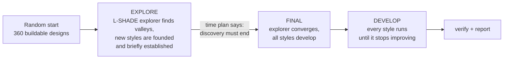

# Discone + HF Vertical Optimizer

**A simulation-driven search for a portable antenna that covers 6 m to 23 cm on transmit, receives from 108 MHz to 2.5 GHz, and folds into a ~1 m tube.**

> 📐 Project page with photos of the build: **[link to portfolio](https://YOUR-PORTFOLIO-URL-HERE)**
> 🛠️ Status: simulation finished for v3, wide-open search (experiment X) ready to run; physical prototype coming soon.

---

## What this is

The antenna is a **discone** (a cone of wires above a disc of rods, naturally very broadband) combined with an **HF vertical**:
- a telescopic whip on top of the cone's body tube
- coil-loaded spokes hanging from the disc as counterpoise for 6 m and 10 m / CB

The idea: one portable antenna that does everything a Diamond D3000N / D1300AM does, plus 6 m and 10 m / CB.

This repository contains the optimizer that designs it. It describes an antenna with 20 parameters, simulates each candidate design with **NEC-2** (method of moments, via [`pynec-accel`](https://pypi.org/project/pynec-accel/)), scores it, and searches the design space for the best designs.

**The goal of the current version (experiment X)** is not to find one single best antenna. It searches a very wide design space and finds as many **different design styles** as possible: distinct families of good designs, like "many short spokes" vs "few long spokes". It then develops each style to its best. That gives a catalogue of options to choose from for the product variants (portable / base station, CB / 10 m), instead of one design you have to take or leave.

```
              |  whip (slid to tune each HF band)
           ___|___  top of the body tube
          \   |   /
           \  |  /     CONE: n wires, opening upward
            \ | /
             \|/   apex hub (diameter dtop)
              :    feed gap
           ---+---  disc hub with m slots; each slot holds ONE of:
          /  /|\  \    - a plain disc rod
         /  / | \  \   - an A spoke (6 m), with a loading coil
            mast       - a B spoke (10 m / CB), with a loading coil
```

---

## Usage

### Requirements

- **Linux** (or WSL on Windows), Python 3.10 or newer
- A multi-core CPU. Every design is ~70 NEC simulations, so more cores = more designs per hour. The full experiment X run is sized for a 192-core cloud machine (see [`docs/AWS_GUIDE_X.md`](docs/AWS_GUIDE_X.md)); small test runs work on a laptop.

### Install

```bash
python3 -m venv nec-venv
source nec-venv/bin/activate
pip install pynec-accel numpy matplotlib cma scikit-learn
```

> NEC and scikit-learn's OpenMP library don't fit into glibc's small "static TLS" memory area together.
> On Linux, `final_opt_x.py` restarts itself once with a larger area. If you ever see
> `cannot allocate memory in static TLS block`, start it like this:
> `GLIBC_TUNABLES=glibc.rtld.optional_static_tls=4096 python3 final_opt_x.py ...`

### Quick start

```bash
python3 final_opt_x.py check                  # simulate one design (the v3 winner) and print its score
python3 final_opt_x.py run --quick            # tiny smoke test of the whole search (results_quick_x/)
python3 final_opt_x.py run                    # the real run (results_x/); continue it with the same command
```

### Commands

| Command | What it does |
|---|---|
| `run` | Start a run, or continue after a stop / crash / reboot |
| `status` | Phase, run time vs deadline, styles found, time plan, speed |
| `pause` / `resume` | Simulations in flight finish, then 0 % CPU / continue |
| `throttle N` | Use at most N cores (`throttle 0` = all again) |
| `stop` | Finish the simulations in flight, save, exit |
| `extend --hours H` | Move the deadline (also while running); continues styles that were cut off |
| `report` | Style catalogue, Pareto front (RF score vs buildability), top designs, best design in detail, plots |
| `report --rf` | Best designs by RF score only |
| `report --band CB40` / `--band 10m` | Re-rank as if only one HF band mattered (for product variants) |
| `verify` | Re-check every style's best design: finer segmentation, stress tests, 2.75 / 3.0 GHz, roof scenario |
| `stats` | The run's learnings: phases, styles, time plan vs reality, clustering, compute per design, pruning |
| `check --set n=16 --set m=24` | Simulate one hand-made design (`--fine` = verify's segmentation) |
| `deck --rank 1 --freq 145` | Write a `.nec` file of a design (open in 4nec2 / xnec2c); `--band CB40` for the HF model |
| `csv` | Rewrite a clean `evals_clean.csv` from the log |

**Options:**
- `--dir FOLDER`: the results folder (default `results_x`)
- `--workers N`: parallel simulations (default: all cores)
- `--quick`: tiny settings for testing
- `--top N`: how many designs `report` / `verify` show
- `--no-plots`: skip the plots in `report`

**Results folder:**
- `evals.jsonl` / `evals.csv`: every simulated design, with its raw results, compute time and size
- `search_state.pkl` + `checkpoint.json`: the complete search state, saved after every batch
- `batches.csv`, `controller.csv`, `clusters.csv`, `shadow.csv`: logs for analysing the run
- the plots from `report`

Scores are recomputed from the stored raw results every time you run `report`. Change a weight or target at the top of the file and re-rank everything without simulating again.

---

## How it works

### 1. The simulation model

Every design is turned into a wire model and simulated with NEC-2:

| Part | How it's simulated |
|---|---|
| **VHF / UHF** (108–2500 MHz) | Antenna in free space, at 12 segments per wavelength. Clean comparisons between designs. |
| **HF** (6 m, 10 m, CB) | Over average ground with the feed at 3.2 m, at 80 segments per wavelength. Includes the aluminium tripod, the coax running down the tripod and along the ground (two lengths: 5 m and 3 m) and a choke at the feed. For each band, the whip is slid to the length with the best SWR across the band, just like tuning it in the field. |
| **Loading coils** | The real self-capacitance of a hand-wound coil is uncertain, and the designs turned out to be sensitive to it. Every coil-sensitive simulation runs at both 0.7 pF and 1.4 pF, and the **worse** result counts. Designs that only work with one specific coil get punished. |

`verify` repeats the finalists at 20 / 120 segments per wavelength to confirm the search's numbers, and adds stress tests: coils at 0.5 / 2.0 pF, the whip pulled out, the antenna on its tripod over ground.

**Hard limits.** Designs that can't be built or simulated are rejected before any simulation:
- **Hub fit:** cone wires, disc rods and spokes must fit around their hubs with 30 % spacing.
- **Disc vs hub:** the disc must be larger than the hub.
- **Spokes:** at least 3 per set, no more than there are slots.
- **Clearances:**
  - every tip ≥ 15 cm from the mast and ≥ 1 m above the ground
  - every rod ≥ 3 cm from the coax
- **Size:** at most 8,000 segments at 2.5 GHz (time and memory per simulation).

Rejected designs get a score of 100,000+ (how far out they are), so the search is gently pushed back into the buildable region.

### 2. Scoring

Each design gets **two scores**:

#### The RF score (what the search optimizes, lower is better)

Each transmit band gets a penalty from its worst SWR across the band:

$$\text{penalty} = w \cdot \Big[(\text{SWR} - 1) + k \cdot \max(0,\ \text{SWR} - \text{target})^2\Big]$$

- **First term:** rewards every bit of improvement.
- **Second term:** a steep wall above the target (k = 10). It makes an SWR above the target expensive, so the optimizer doesn't trade one band for another.

| Band | Frequencies (MHz) | Target SWR | Weight |
|---|---|---|---|
| 6 m | 50.0 – 51.0 | 1.45 | 0.7 |
| 10 m | 28.2 – 28.8 | 1.45 | pair rule |
| CB (40 channels) | 26.965 – 27.405 | 1.45 | pair rule |
| 2 m | 144 – 146 | **1.3** (wall k = 30) | 1.0 |
| 70 cm (incl. 433 MHz ISM) | 430 – 440 | 1.45 | 1.0 |
| ISM 868 + 915 (EU + US / 33 cm) | 863 – 876, 902 – 928 | 1.45 | 1.0 |
| 23 cm | 1240 – 1300 | 1.45 | 0.4 |
| Receive | 24 points, 108 – 2500 | ≤ 3.0 is free | 0.5 per SWR unit above 3 |

The 1.45 targets leave margin to honestly advertise **SWR < 1.5** after build tolerances.

On top of the SWR terms:

- **Radiation pattern:** at the centre of each VHF/UHF band, the gain around the horizon (±10°) is computed. Below a floor it costs 0.2 per dB; above it there's a small bonus of 0.05 per dB (up to 2 dB). An antenna that matches well but radiates into the sky is not useful.
- **HF gain:** low-angle HF gain (3–20° elevation) below −3 dBi costs 0.2 per dB.
- **The 10 m / CB pair rule:** a plain sum of two penalties prefers "both bands mediocre" over "one band excellent". For a product, that's backwards: a CB version and a 10 m ham version are both fine products. So the pair counts the **better band 90 % and the worse band 10 %**:

  $$\text{pair} = 1.6 \cdot \big[0.9 \cdot \min(p_{10m}, p_{CB}) + 0.1 \cdot \max(p_{10m}, p_{CB})\big]$$

  Both good is still best, and both bad is still worst. Which band a style specializes in is left to the search. The report tags every style **CB / 10 m / both**, and `report --band` re-ranks for one band.

#### Buildability (only for us, 0–10, higher is better)

The search **ignores** this score completely. It exists so the results can be judged on more than RF performance:

| Part | Points |
|---|---|
| Inside the proven v3 parameter ranges | 4, minus 1 per 20 % of a parameter's range a design lies outside |
| Sturdy elements | 2 for the cone wires + 2 for the disc rods, full at ≥ 3 mm diameter |
| Compact (portable) | 2 if the longest part is ≤ 1.0 m (fits a 1 m tube), 0 at ≥ 1.6 m |
| Coils | −0.5 per coil beyond 7, −2 if there is no plain disc rod at all |

`report` shows the **Pareto front**: the designs no other design beats on *both* scores. That's the trade-off curve between "best RF" and "easiest to build".

### 3. The search at a glance

The search runs in phases against a fixed deadline (20 hours of run time):



Three ideas carry the whole thing:
1. An **explorer** (L-SHADE) keeps the search wide.
2. **Styles** (CMA-ES runs) each take one valley of the score landscape and push it down.
3. A **time controller** decides how long to keep discovering new styles, so all of them can still be fully developed before the deadline.

Designs are evaluated in **batches** of about one design per CPU core. Each design is ~70 simulations, and they're started longest-first across the whole batch, so the cores stay busy. A batch mixes part of an explorer generation with one step of every running style.

### 4. The explorer: L-SHADE

The explorer is **L-SHADE** (Tanabe & Fukunaga, 2014), an adaptive form of **differential evolution (DE)**. All parameters are scaled to 0…1.

**Making new designs.** For each member $x_i$ of the population, a trial design is built:

$$v = x_i + F\,(x_{pbest} - x_i) + F\,(x_{r1} - x_{r2})$$

- $x_{pbest}$ is a random member of the best 11 %. This pulls towards good regions.
- $x_{r1}$ and $x_{r2}$ are random members. Their difference gives a step in a direction the population itself suggests.
- **Crossover:** each parameter of the trial is taken from $v$ with probability CR, otherwise from $x_i$.
- **Selection:** the trial replaces its parent only if it scores at least as well.

**Learning F and CR.** Plain DE uses fixed values for the step size F and the mixing rate CR. L-SHADE learns them:
- Each trial draws its F (Cauchy distribution) and CR (normal distribution) around values from a small memory.
- After every generation, the F and CR values of the trials that **beat their parent** are written back into the memory, weighted by how much they improved.
- The memory drifts towards settings that work for this landscape.

**Archive.** Parents that lost to their trial go into an archive. $x_{r2}$ may be drawn from it, which adds diversity to the steps.

**Population size reduction.** Standard L-SHADE shrinks its population linearly from large (broad exploration) to small (fine convergence) over a fixed budget of evaluations. Here the budget isn't fixed, because it depends on how many styles turn up. So the shrinking is handed to the **time controller** (section 7):
- **Starting size:** 360 designs (18 × 20 parameters).
- **Before 4 styles exist:** no shrinking at all, unless the time plan says time is getting short ("panic": once it needs ≥ 3 % per generation, it keeps shrinking).
- **From 4 styles on:** after every generation, the population shrinks by exactly the rate that brings it to **64 designs at the planned end of discovery**: $r = 1 - (64 / N)^{1/G}$, with $N$ = current size and $G$ = generations left. At most 10 % per generation. The worst members leave.
- **Reaching 64 ends discovery.**

Because the explorer's generation is spread over several batches, it runs in parallel with the styles without either one waiting.

### 5. Finding styles: clustering + hill-valley tests

**Detection.** From generation 8, after every explorer generation:
1. The explorer's **top 30 %** are clustered with **HDBSCAN**. HDBSCAN finds clusters at every density level and keeps those that persist, so there's no distance threshold to guess, and valleys of different shapes are handled. It uses fine "leaf" clusters, with "excess of mass" as a fallback when a population has converged into one tight blob.
2. Each style's current position goes into the same clustering: its best design, its CMA-ES mean and its recent good samples. A cluster that contains them belongs to an existing style.
3. A cluster that belongs to no style becomes a **candidate**, if its best design is in the explorer's top 10 %.

**The hill-valley test** decides whether a candidate is really new:
1. Three designs are simulated on the straight line between the candidate's best and the nearest style's best, at 25 / 50 / 75 %.
2. If any of them is clearly worse than **both** ends, there's a ridge between them: two separate valleys. The candidate is then tested against the next-nearest style, up to 3.
3. If there's no ridge, they're the same valley, and the candidate is dropped.

This costs only ~2–3 % of the explorer's designs. On test landscapes it cut duplicate styles from 11–132 down to 0–1, compared with the earlier "does it touch a stored point" rule.

**Taboo.** Left alone, L-SHADE's pull towards its best members makes the whole population collapse into the single best valley. In tests, 95 % of its designs ended up there. But a valley that already has a style is being developed anyway; the explorer's job is to find *other* valleys. So after every generation, explorer members in a known style's valley are **replaced by fresh random designs**. With this taboo, a test landscape with 7 valleys produced 6–7 styles, one per valley, instead of 3.

**Merge check.** A style's optimizer can drift out of its own shallow valley into a deeper neighbour that already has a style. Every 10 steps, each running style is hill-valley tested against its nearest style. If they turn out to share a valley, the worse one stops ("merged into style N").

> Earlier versions (v3) had the same idea in a simpler form, called **trends**:
> - **Detection:** nearest-better clustering found families of good designs in an L-SHADE explorer.
> - **Development:** one CMA-ES run developed each family.
> - **Taboo:** a fixed taboo radius kept new trends away from old ones.
>
> Experiment X replaces the fixed radius with HDBSCAN + hill-valley tests, and runs many styles side by side.

### 6. Developing styles: CMA-ES

Each style is an independent **CMA-ES** run (Covariance Matrix Adaptation Evolution Strategy, via `pycma`):
1. It samples a batch of designs from a multivariate normal distribution.
2. It moves the mean towards the best ones.
3. It learns the shape of the valley (the covariance), so it can follow narrow, tilted valleys that DE handles poorly.

**Starting point.** A style starts from its cluster: the mean is a weighted average biased to the best member, and the initial step size and per-parameter scales come from the cluster's spread. The whole-number parameters (n, m, kA, kB) stay those of the design that founded the style; CMA-ES moves the other 16.

**Lifecycle.**
- **Establish:** a new style runs 8 steps, then pauses until the final phase. At most 3 establish at the same time.
- **Pilot:** the very first style is developed fully right away. That measures what a full development costs, which the time plan needs.
- **Finished:** a style ends when 10 steps bring less than 0.005 improvement.
- **Step size:** a step is half a batch (96 designs on 192 cores) for styles inside the proven v3 ranges, and a quarter batch (48) for the rest.

**Compute split.** While styles establish, the batch is shared between them and the explorer:

| Style's buildability | Split (style / explorer) |
|---|---|
| Inside the v3 ranges | 50 / 50 |
| Outside | 20 / 80 |

This is the only place where buildability influences the search: easy-to-build styles get more attention while they establish.

**Final phase.** When the explorer has shrunk to 64:
- every paused style resumes, and all styles develop side by side
- the remaining explorer population runs on (now removing designs that fall into known valleys) until 10 generations bring < 0.1 %, or for at most 60 generations
- its clusters become styles too

### 7. The time controller

The run has one deadline: **20 hours of run time**. The difficult question is when to stop discovering new styles. Stop too early and you miss styles; too late and the found ones can't be developed. After every explorer generation the controller re-plans:

**Measure:**
- **Speed:** designs per hour with all cores busy, from the measured compute time per design. Style designs and explorer designs are averaged separately; they differ in size.
- **Development length:** how many steps a full development takes. A prior of 40 until the pilot has measured it, then the median of all finished styles.
- **Discovery rate:** how often new styles appear, per explorer generation. Recent discoveries count more (each generation weighs 3 % less), so a dried-up search isn't expected to keep producing.

**Forecast the remaining work** if discovery continues for $G$ more generations:

$$W(G) = \sum_{\text{styles}} \lambda_s \cdot \text{steps left}_s \;+\; (\text{rate} \cdot G + 1)\cdot \bar\lambda \cdot \text{steps per development} \;+\; \text{final population}$$

The development time is the larger of $W / \text{speed}$ and the longest chain of steps that must run one after another. A CMA-ES step can't start before the previous one is finished, so even with spare cores a development takes a minimum time.

**Solve:** find the largest $G$ for which $G \cdot t_{\text{generation}} + T_{\text{development}}(G)$ still fits before the deadline. This is a bisection, since more discovery means more styles to develop. The planned **end of discovery** is now + $G$ generations.

**Act:** the explorer shrinks at the rate that reaches 64 at that moment (section 4).
- **Spare time:** a slower shrink and longer discovery.
- **Short time:** a faster shrink ("panic").

**Hidden buffer.** The controller plans for 20 h, but the search only stops at 20.5 h. Forecast errors use up that half hour instead of cutting off styles, and the last 30 minutes before a hard stop at 21 h go to `verify` and `report`. Styles still running at the stop are marked **cut off** with how much of their patience they had used, and `extend --hours` continues them later.

On test landscapes with simulated run times, the plan errs slightly on the safe side: development forecast 4.9 h vs 3.7 h actual, runs done at 16–17.7 h of 20.

### 8. Shadow-mode pruning

HF simulations (whip tuning over ground) are ~70 % of each design's compute. Since every HF penalty is ≥ 0, a trial whose VHF/UHF part alone already scores worse than its parent can never win, so its HF simulations could be skipped. This run only **measures** that idea (nothing is skipped) for two rules:
- **Exact rule:** the non-HF part alone loses to the parent. This can never be wrong.
- **Near-exact rule:** the trial would need better HF results than any design in the population has.

`stats` reports, per rule, how many trials it would have skipped, how many core-hours that would have saved, and how often it would have been wrong. That decides whether a future run switches pruning on.

### 9. Robustness

- **Checkpoints:** the complete search state is saved after every batch: explorer, all CMA-ES runs with their random number generators, candidates and the time plan. A stop, crash, reboot or cloud spot interruption costs at most one batch.
- **Exact resume:** a resumed run makes exactly the same designs as an uninterrupted one. This is tested by stopping and crashing runs mid-batch and comparing the full design sequence.
- **Geometry checks:** NEC's overlap checks stay on, so the optimizer can't exploit physically impossible geometry. The wire model was made robust for the extreme corners of the design space; 0 of 800 random designs fail across all 39 simulated frequencies.

---

## Repository layout

```
final_opt_x.py          the optimizer (one self-contained file)
setup_aws_x.sh          turns a fresh Ubuntu cloud machine into the optimizer (installs, self-test, service)
docs/
  AWS_GUIDE_X.md        step-by-step guide for the 20-hour cloud run
  experiment-x-spec.md  the full specification with all numbers and decisions
  learnings.md          what each test showed and what was changed because of it
results/                selected results, plots and reports (after the run)
```

## Acknowledgements

- **NEC-2:** the Numerical Electromagnetics Code (Burke & Poggio, LLNL), via the necpp / PyNEC lineage.
- **L-SHADE:** R. Tanabe & A. Fukunaga, *Improving the Search Performance of SHADE Using Linear Population Size Reduction*, IEEE CEC 2014.
- **CMA-ES:** N. Hansen, [`pycma`](https://github.com/CMA-ES/pycma).
- **HDBSCAN:** Campello, Moulavi & Sander, 2013; implementation from scikit-learn.
- **Hill-valley test:** after S. C. Maree et al., *Real-valued evolutionary multi-modal optimization driven by hill-valley clustering*, GECCO 2018.

## License

*TODO: choose a license.*
